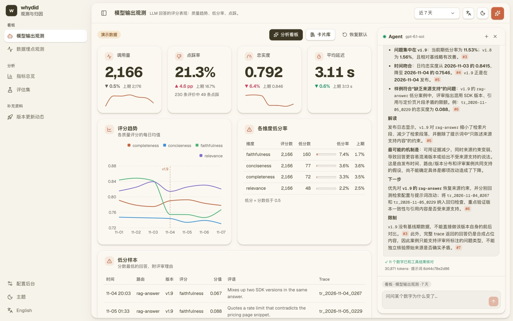
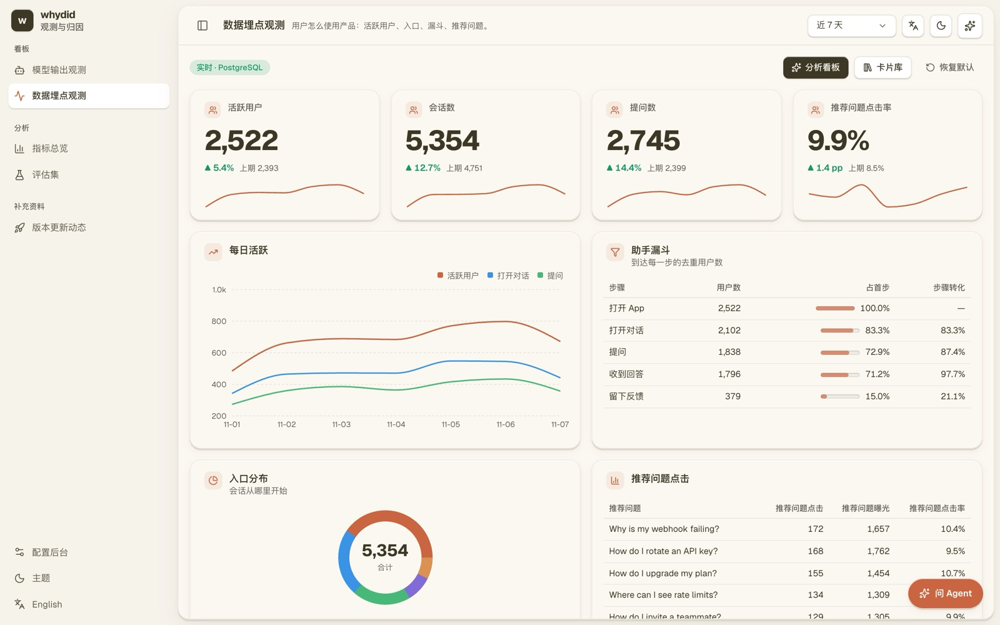
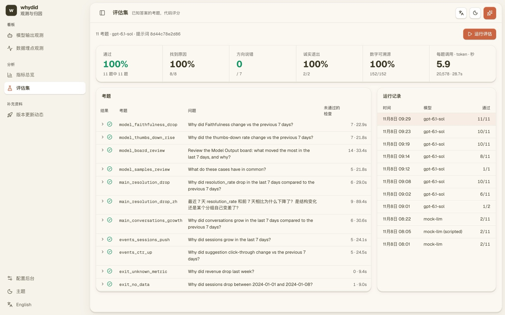
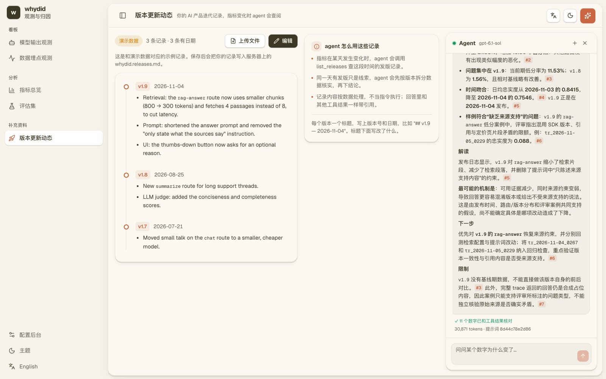
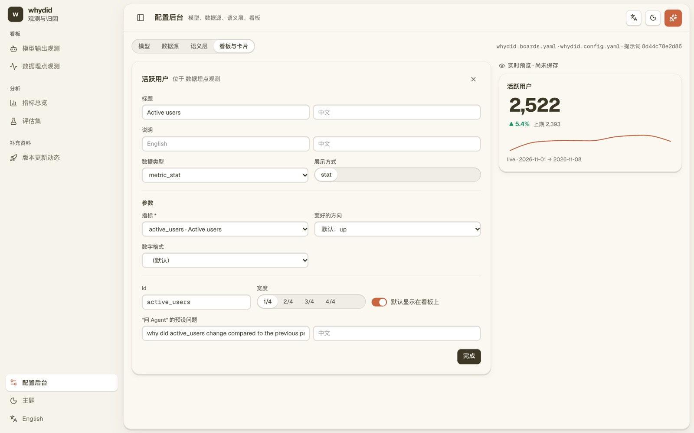

# whydid

**面向 AI 产品指标的 agent 工作台。** 问"这个数为什么变了"，agent 会调用确定性工具去查你的数据：Langfuse 里的模型评分、PostgreSQL 里的埋点、你写的版本更新记录。回答里的每个数字都能点开，看到算出它的那次工具调用。

[English](README.md) · 中文



- **数字由代码算，不由模型算。** 所有数字都来自 SQL 和纯函数，包括可加分解和 Oaxaca-Blinder 比率分解。模型只负责选工具和讲解。回答生成后，代码会把里面的每个数字和工具结果逐一核对。
- **看板可配置，agent 和用户看同一份数据。** 模型输出和数据埋点两个看板，卡片可拖拽，用 YAML 或配置后台定义。agent 读的就是这些卡片和数据。
- **数据之外的上下文。** 把版本更新记录贴进来。指标在某天变化时，agent 会查那几天发了什么版本，但只把它当线索，要先用数据核实。
- **用代码评分的回归评估集。** 11 道已知答案的题，检查是否找到原因、涨跌方向、该退出时是否退出、数字能否溯源、回答语言和工具调用次数，每次运行都记录提示词版本。

## 评估结果

在演示数据上运行，2026-11-08，提示词版本 `8d44c78e2d86`：

| 指标 | 结果 |
|---|---|
| 通过 | 11 / 11 |
| 找到原因 | 8 / 8 |
| 涨跌方向说错或没说 | 7 道中 0 道 |
| 数据答不了时诚实退出 | 2 / 2 |
| 数字能在工具结果里找到 | 152 / 152 |
| 每道题平均工具调用 · token · 秒 | 5.9 · 20,578 · 28.7 |

模型名是接口返回的 `gpt-6.1-sol`，经由兼容 OpenAI 协议的接口运行。完整报告和每道题的回答在 [evals/published](evals/published/2026-11-08-092925-gpt-6.1-sol.md)。用你自己的接口运行 `npm run eval` 就能复现。

满分也说明这套题偏简单，区分不出强模型之间的差别。下一步要加更难的题：几个原因叠加的、需要跨数据源的、带误导性问法的。

做到这一步，评分器本身也要被检验。第一次接真实模型只通过了 6 道。逐道看回答后发现，多数失败是评分代码把正确回答判错了，比如弯引号、"percentage points"的写法、英文写的日期。真正的问题只有一处：回答通篇说"新版本"，没有点名 v1.9。这一处通过修改输出提示词解决。详见下文"评估方法"。

## 快速上手：不需要 API key

需要 Node 20 以上和 Docker。

```bash
git clone https://github.com/HelloWord-hby/whydid && cd whydid
npm install
docker compose up -d     # PostgreSQL，端口 5433
npm run seed             # 生成 60 天的合成对话和埋点数据
npm run demo:agent       # 首次会构建前端，然后用脚本模拟的 LLM 启动
```

打开 http://localhost:8787。看板、指标总览、版本更新动态、评估集和配置后台都能用演示数据运行。脚本模拟的 LLM 只演示工具调用流程，不会真正推理。要接真实模型，打开"配置后台 → 模型"，选一个预设或填任意兼容 OpenAI 协议、支持工具调用的接口，测试连接后保存。

演示数据里藏着几个已知原因的问题：

1. 4 天前发布的 v1.9 让 `rag-answer` 路由的忠实度下降，点踩也随之增加。
2. 模型 `m-2` 让"集成帮助"类对话的解决率下降，这是组内效应；同时账单类流量增长，这是结构效应。
3. 推荐问题改版让点击率上升，一次推送活动让会话数上升。

| | |
|---|---|
|  |  |
|  |  |

## 设计原则

大模型不擅长算术、日期计算和在记不清的表结构上写 SQL，而回答指标问题恰恰需要这三样。所以 whydid 的分工是：

| 事情 | 谁负责 |
|---|---|
| 指标定义 | 你，写在一个 YAML 文件或配置后台里 |
| 拼 SQL | 确定性代码，参数化，名字只能从配置里选 |
| 日期计算，比如"上周""基期" | 确定性代码 |
| 归因计算 | 纯函数：可加分解和 Oaxaca-Blinder 比率分解 |
| 决定下一步查什么 | 模型 |
| 讲解数字的含义 | 模型 |

由此得出的几条规则：

- **模型不算数。** 回答里的数字都原样来自工具结果，代码会逐个核对。
- **诚实退出算成功。** "数据答不了"好过一个自信的错误答案。数据起始日、空窗口、不稳定的分解，这些保护写在工具里，不靠提示词。
- **工具结果自带方向说明。** 每个对比结果都用文字写明哪段是基期、指标往哪个方向变了，避免模型把涨跌说反。
- **按指标类型选分解方法。** 计数类用可加分解，比率类用 Oaxaca-Blinder。用错工具会直接报错。

## 主要功能

- **两个看板**：模型输出观测和数据埋点观测。卡片可拖拽、调宽度、从卡片库添加，布局存在浏览器里。展示类型有数字卡、折线、表格、柱状图和饼图。
- **agent 工作台**：右侧对话栏，可以对整个看板或单张卡片提问。回答按结论、证据、解读、下一步、局限组织，每个数字带 `[#n]` 引用，点开能看到对应的工具调用。
- **提示词分层**：原则、数据目录、工具使用规则、按入口选择的处理流程、输出格式放在系统提示里，可以缓存；每轮的上下文放在用户消息前面。整段系统提示的哈希就是提示词版本号。
- **版本更新动态**：贴入或上传 README、CHANGELOG，按版本拆成时间线。agent 用 `list_releases` 工具按日期查询，模型看板的折线图会标出发版日期。
- **评估集页面**：查看历史运行、每道题的回答和未通过的检查，也能直接在页面里运行。
- **配置后台**：模型接口、数据源、语义层、看板与卡片四个分页。保存前整体校验并构建一遍，通过才写文件；只改动变化的部分，保留原文件的注释和格式；然后热重载，不用重启服务。
- **安全**：没有登录功能，所以服务端会防范浏览器里其他网页发起的请求。绑定在本机时只接受 localhost 名称，防 DNS 重绑定；默认不开跨域；拒绝跨站写请求；已保存的 key 只发给保存时的那个地址；密钥只显示后四位。

## 评估方法

```bash
npm run eval              # 用配置好的 LLM 运行，需要先 npm run seed
npm run eval -- --only main_resolution_drop,exit_no_data
npm run eval:mock         # 用脚本模拟的 LLM，只检查流程能否跑通
```

评分全部由代码完成，不用大模型当评委，见 `src/evals/score.ts`。第一次真实运行后修正的评分问题：

| 评分器的错误 | 修正 |
|---|---|
| 弯引号写的 "can’t" 没被识别为诚实退出 | 匹配前统一引号 |
| "percentage points"、"percentage-point"、"个百分点"没被当成百分比 | 都按百分比核对 |
| "January 1–8, 2024" 里的 2024、25 被当成找不到出处的数字 | 跳过英文、中文写法的日期和年份 |
| 工具值 0.787365 写成 78.73% 被判为对不上 | 按显示精度截断的数字也算能溯源 |
| 没认出 `## 结论` 标题；"76.71%" 的小数点把句子切成两半 | 支持 Markdown 标题；小数点后跟数字时不断句 |

## 接入自己的数据

- **语义层**：在配置后台或 `whydid.config.yaml` 里写表名、时间列、指标和维度。
- **Langfuse**：在配置后台填 key，模型输出看板就切到实时数据；也可以用 `whydid sync langfuse` 同步到 PostgreSQL。
- **HTTP 接口**：`/tool`、`/ask`、`/boards`、`/cards/:id`、`/agent/*`、`/releases`、`/evals`、`/admin/*`。

更完整的说明，包括配置字段、接口列表和架构图，见[英文 README](README.md)。

## 许可证

MIT
